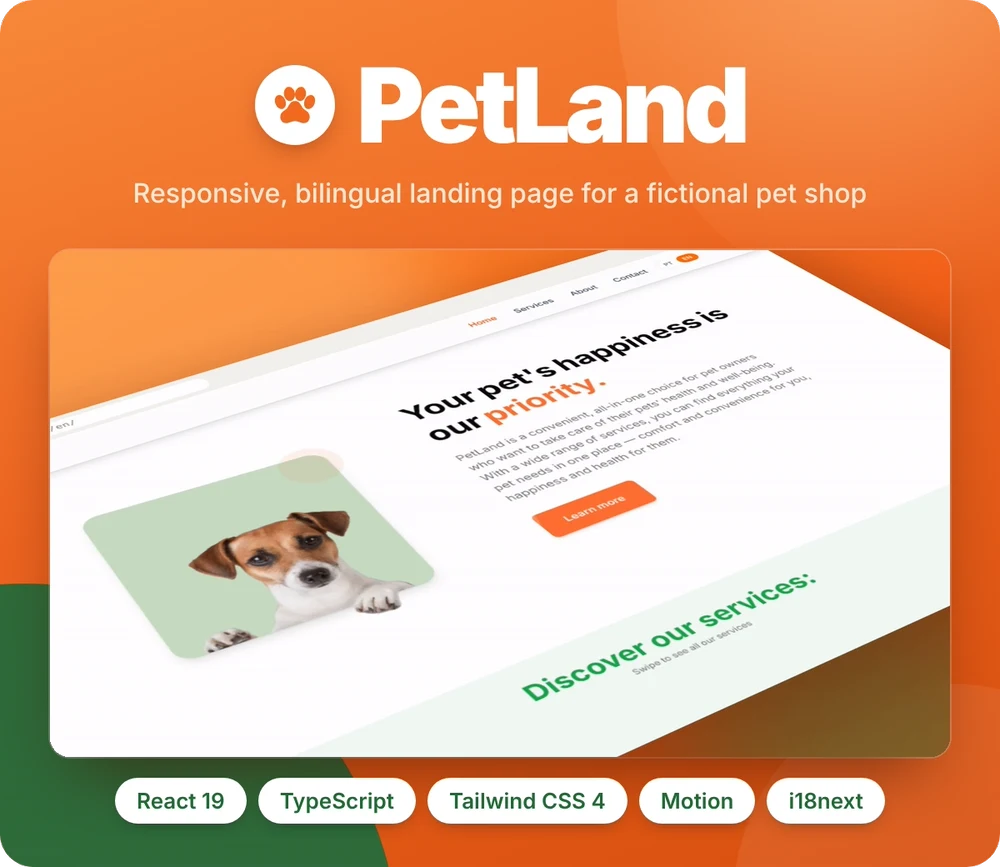
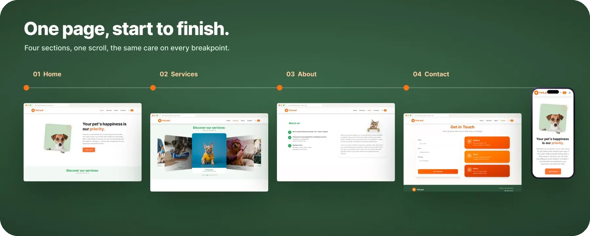
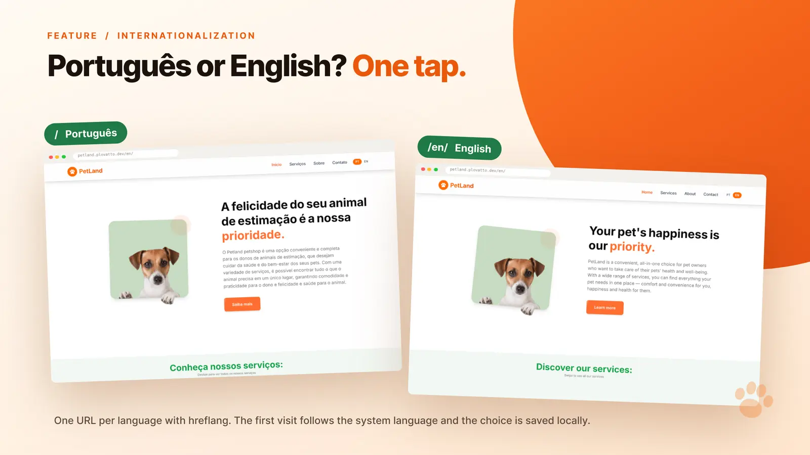
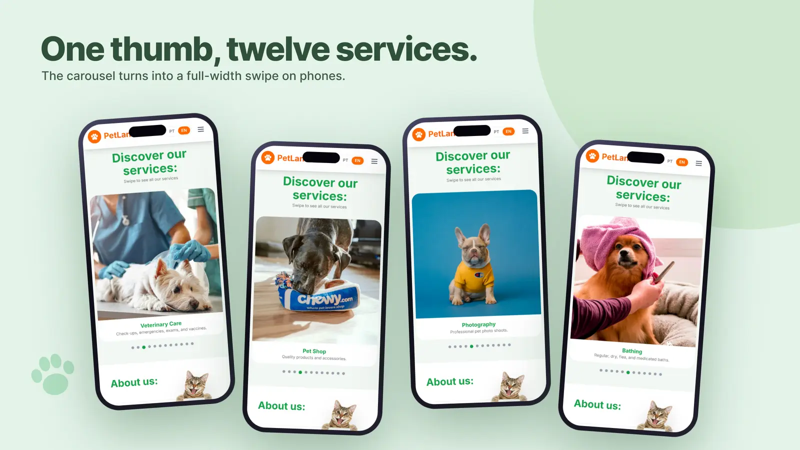
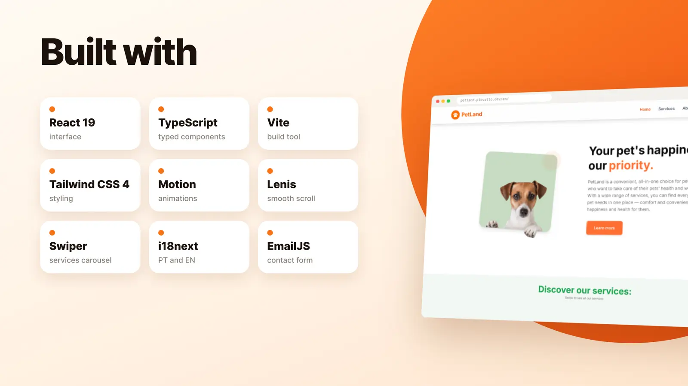
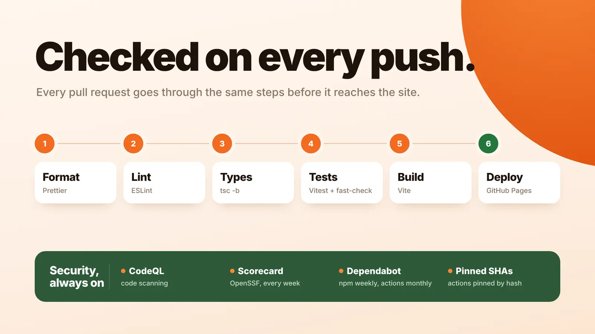

<div align="center">
  <a href="https://petland.plovatto.dev/en/">
    <picture>
      <source media="(prefers-reduced-motion: reduce)" srcset="./.github/assets/hero-still-en.webp">
      
    </picture>
  </a>

  <br>
  <br>

<a href="https://petland.plovatto.dev/en/"></a>
&nbsp;
<a href="README.pt-BR.md"></a>

  <br>
  <br>

<a href="https://github.com/Plovatto/PetLand/actions/workflows/ci.yml"></a>
<a href="https://scorecard.dev/viewer/?uri=github.com/Plovatto/PetLand"></a>
<a href="https://www.bestpractices.dev/projects/16067"></a>
<a href="LICENSE"></a>
</div>

<br>

<p align="center">PetLand is the landing page of a fictional pet shop: one scroll, four sections, two languages. It is part of my portfolio and was built to practice front-end development, responsiveness, component organization, internationalization, and React application deployment.</p>

<br>

<details>
<summary><strong>Table of contents</strong></summary>

- [Overview](#overview)
- [Português or English? One tap.](#português-or-english-one-tap)
- [One thumb, twelve services](#one-thumb-twelve-services)
- [Open it on your phone](#open-it-on-your-phone)
- [Features](#features)
- [Tech stack](#tech-stack)
- [Quality and security](#quality-and-security)
- [Getting started](#getting-started)
- [Scripts](#scripts)
- [Project structure](#project-structure)
- [Deployment](#deployment)
- [Project goals](#project-goals)
- [Contributing](#contributing)
- [Security](#security)
- [Changelog](#changelog)
- [Author](#author)
- [License](#license)

</details>

## Overview

Home, services, about, and contact in a single scroll, with the same care on every screen size.



## Português or English? One tap.

Each language has its own URL with `hreflang`. The first visit follows the system language, and the choice is saved in the browser.



## One thumb, twelve services

On phones, the services carousel spans the full width and works with a swipe.



## Open it on your phone

The site is live on GitHub Pages in both languages.

<a href="https://petland.plovatto.dev/en/"></a>

## Features

Everything a small business site needs, built with care.

<table>
  <tr>
    <td width="50%" valign="top">
      
      <h3>Responsive everywhere</h3>
      <p>A layout tuned for every screen size, with a full-width, swipeable services carousel on phones.</p>
    </td>
    <td width="50%" valign="top">
      
      <h3>Two languages, two URLs</h3>
      <p>Portuguese at <code>/</code> and English at <code>/en/</code> with <code>hreflang</code>. The first visit follows the system language, and the choice is saved locally.</p>
    </td>
  </tr>
  <tr>
    <td width="50%" valign="top">
      
      <h3>Motion with care</h3>
      <p>Smooth scrolling with Lenis, a custom cursor, a page loader, and microinteractions that respect "reduce motion".</p>
    </td>
    <td width="50%" valign="top">
      
      <h3>A contact form that works</h3>
      <p>Messages are sent with EmailJS, next to the address, phone, and opening hours.</p>
    </td>
  </tr>
  <tr>
    <td width="50%" valign="top">
      
      <h3>Ready for search</h3>
      <p>Meta tags, structured data, <code>robots.txt</code>, <code>sitemap.xml</code>, and images optimized as WebP.</p>
    </td>
    <td width="50%" valign="top">
      
      <h3>Tested and checked</h3>
      <p>Translation tests with Vitest and fast-check, plus lint, types, build, and Lighthouse on every pull request.</p>
    </td>
  </tr>
</table>

## Tech stack

Nine libraries, each with one clear job.



<details>
<summary>See every tool and what it is used for</summary>

| Technology                                                                        | Used for                              |
| :-------------------------------------------------------------------------------- | :------------------------------------ |
| [React](https://react.dev/) 19 + [TypeScript](https://www.typescriptlang.org/)    | Interface and typed components        |
| [Vite](https://vite.dev/)                                                         | Development server and build          |
| [Tailwind CSS](https://tailwindcss.com/) 4                                        | Styling                               |
| [Framer Motion](https://motion.dev/)                                              | Animations and transitions            |
| [Lenis](https://lenis.darkroom.engineering/)                                      | Smooth scrolling                      |
| [Swiper](https://swiperjs.com/)                                                   | Services carousel                     |
| [i18next](https://www.i18next.com/) + [react-i18next](https://react.i18next.com/) | Internationalization                  |
| [EmailJS](https://www.emailjs.com/)                                               | Contact form delivery                 |
| [Vitest](https://vitest.dev/) + [fast-check](https://fast-check.dev/)             | Unit and property-based tests         |
| ESLint + Prettier                                                                 | Code analysis and formatting          |
| GitHub Actions + GitHub Pages                                                     | CI, automated deployment, and hosting |

</details>

## Quality and security

Every pull request goes through the same checks before it reaches the site.



<details>
<summary>How each check works</summary>

- The [`ci.yml`](.github/workflows/ci.yml) workflow checks formatting, lint, types, tests, and build on every push and pull request to `main`.
- [Lighthouse CI](.github/workflows/lighthouse.yml) audits `/` and `/en/` on every pull request and fails if accessibility, best practices, or SEO drop below 95.
- Pull request titles are checked against the same gitmoji and Conventional Commits format as the commits.
- [CodeQL](https://github.com/Plovatto/PetLand/security/code-scanning) scans the code, and the [OpenSSF Scorecard](https://scorecard.dev/viewer/?uri=github.com/Plovatto/PetLand) runs every week.
- Dependabot updates npm dependencies weekly and GitHub Actions monthly.
- Every action in the workflows is pinned to a commit hash.

</details>

## Getting started

Requires [Node.js](https://nodejs.org/) 24 (see [`.nvmrc`](.nvmrc)) and npm.

1. Clone the repository and install the dependencies:

   ```bash
   git clone https://github.com/Plovatto/PetLand.git
   cd PetLand
   npm install
   ```

2. Create the environment file:

   ```bash
   cp .env.example .env.local
   ```

3. Fill in your EmailJS credentials in `.env.local`:

   ```env
   VITE_EMAILJS_SERVICE_ID=
   VITE_EMAILJS_TEMPLATE_ID=
   VITE_EMAILJS_PUBLIC_KEY=
   ```

4. Start the development server and open <http://localhost:5173>:

   ```bash
   npm run dev
   ```

> [!IMPORTANT]
> Do not commit `.env.local`. Without the credentials the site works normally, but the contact form does not send messages.

## Scripts

| Command                | Description                                          |
| :--------------------- | :--------------------------------------------------- |
| `npm run dev`          | Starts the development server                        |
| `npm run build`        | Runs the type check and creates the production build |
| `npm run preview`      | Serves the production build locally                  |
| `npm run lint`         | Runs ESLint                                          |
| `npm run typecheck`    | Runs the type check                                  |
| `npm test`             | Runs the tests                                       |
| `npm run test:watch`   | Runs the tests in watch mode                         |
| `npm run format`       | Formats the code with Prettier                       |
| `npm run format:check` | Checks formatting without changing files             |
| `npm run lighthouse`   | Runs Lighthouse CI against the production build      |

## Project structure

<details>
<summary>View the folder tree</summary>

```text
src/
├── assets/                 # Images and SVGs used by components
├── components/
│   ├── layout/             # Structural components, such as Header, Footer, and PageLoader
│   ├── sections/           # Page sections, such as Hero, Services, About, and Contact
│   └── ui/                 # Reusable components, such as AnimatedText and LanguageToggle
├── constants/              # Static data, links, and section settings
├── context/                # Global application contexts
├── hooks/                  # Custom hooks
├── lib/                    # Utility functions
├── locales/                # Translation files
│   ├── en/
│   └── pt/
├── styles/
│   └── index.css           # Global styles and Tailwind CSS setup
├── App.tsx
├── i18n.ts
└── main.tsx
```

</details>

## Deployment

<details>
<summary>How the site is published to GitHub Pages</summary>

Deployment runs through the [`deploy.yml`](.github/workflows/deploy.yml) workflow. On every push to `main`, it builds the project and publishes the `dist` folder.

The site is served on the custom domain `petland.plovatto.dev`, so Vite uses `base: '/'`. To publish, create a `CNAME` DNS record from `petland` to `plovatto.github.io` and configure GitHub:

```text
Settings > Pages > Build and deployment > Source: GitHub Actions
Settings > Pages > Custom domain: petland.plovatto.dev
```

</details>

## Project goals

PetLand was built to practice and demonstrate:

- React and TypeScript interfaces with reusable components
- Responsive layouts and front-end project organization
- Animations, microinteractions, and respect for motion preferences
- Accessibility and internationalization
- Integration with external services
- Automated deployment and Git and GitHub best practices

## Contributing

Issues and pull requests are welcome. Read the [contributing guide](CONTRIBUTING.md) for the branch, commit, and pull request conventions, and follow the [code of conduct](CODE_OF_CONDUCT.md).

## Security

Please do not open public issues for vulnerabilities. Report them privately as described in the [security policy](SECURITY.md).

## Changelog

Notable changes for each release are listed in the [CHANGELOG](CHANGELOG.md) and on the [releases page](https://github.com/Plovatto/PetLand/releases).

## Author

**Pandora Becker Lovatto** · [@Plovatto](https://github.com/Plovatto)

## License

Distributed under the [MIT License](LICENSE).

<br>

<p align="center"><a href="#readme"></a></p>
