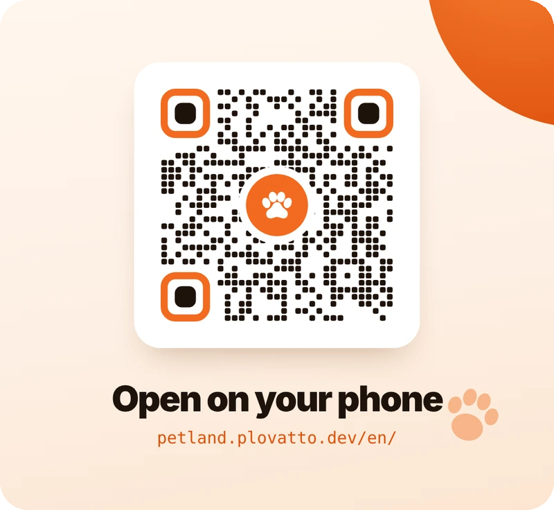

<div align="center">
  <a href="https://petland.plovatto.dev/en/">
    <picture>
      <source media="(prefers-reduced-motion: reduce)" srcset="./.github/assets/hero-still-en.webp">
      
    </picture>
  </a>

  <br>
  <br>

<a href="https://petland.plovatto.dev/en/"></a>
&nbsp;
<a href="README.pt-BR.md"></a>

  <br>
  <br>

<a href="https://github.com/Plovatto/PetLand/actions/workflows/ci.yml"></a>
<a href="https://scorecard.dev/viewer/?uri=github.com/Plovatto/PetLand"></a>
<a href="https://www.bestpractices.dev/projects/16067"></a>
<a href="LICENSE"></a>
</div>

<br>

PetLand is a single page with four sections (home, services, about, and contact), designed to be pleasant, accessible, and fast on any screen. It is part of my portfolio and was built to practice front-end development, responsiveness, component organization, internationalization, and React application deployment.

> [!NOTE]
> This is a fictional project and does not represent a real company.

<details>
<summary><strong>Table of contents</strong></summary>

- [Demo](#demo)
- [Overview](#overview)
- [Highlights](#highlights)
- [Features](#features)
- [Tech stack](#tech-stack)
- [Quality and security](#quality-and-security)
- [Getting started](#getting-started)
- [Scripts](#scripts)
- [Project structure](#project-structure)
- [Deployment](#deployment)
- [Project goals](#project-goals)
- [Contributing](#contributing)
- [License](#license)

</details>

## Demo

Live on GitHub Pages: **[petland.plovatto.dev/en/](https://petland.plovatto.dev/en/)** in English and **[petland.plovatto.dev](https://petland.plovatto.dev/)** in Portuguese.

<p align="center">
  
</p>

## Overview


One scroll from start to finish, with the same care on every screen size.

## Highlights

### Português or English? One tap.


Each language has its own URL with `hreflang`. On the first visit, the site follows the system language, and the choice is saved in the browser.

### One thumb, twelve services


On phones, the services carousel spans the full width and works with a swipe.

### Details that make the difference

- **Smooth scrolling** with Lenis and navigation that highlights the current section.
- **Custom cursor** and a **page loader** with the brand identity.
- **Motion that respects the user:** with "reduce motion" turned on in the system, transitions are simplified.

## Features

**Experience**

- Responsive layout for different screen sizes
- Smooth navigation between sections
- Animations and microinteractions with reduced motion support
- Smooth scroll, custom cursor, and page loader

**Content**

- Home, Services (with carousel), About, and Contact sections
- Contact form integrated with EmailJS
- Footer with the brand's visual identity

**Languages, SEO, and performance**

- Portuguese and English, with one URL per language (`/` and `/en/`) and `hreflang`
- Initial language based on the system, with the choice saved locally
- Meta tags, structured data, `robots.txt`, and `sitemap.xml`
- Assets optimized as WebP

## Tech stack


| Technology                                                                        | Used for                              |
| :-------------------------------------------------------------------------------- | :------------------------------------ |
| [React](https://react.dev/) 19 + [TypeScript](https://www.typescriptlang.org/)    | Interface and typed components        |
| [Vite](https://vite.dev/)                                                         | Development server and build          |
| [Tailwind CSS](https://tailwindcss.com/) 4                                        | Styling                               |
| [Framer Motion](https://motion.dev/)                                              | Animations and transitions            |
| [Lenis](https://lenis.darkroom.engineering/)                                      | Smooth scrolling                      |
| [Swiper](https://swiperjs.com/)                                                   | Services carousel                     |
| [i18next](https://www.i18next.com/) + [react-i18next](https://react.i18next.com/) | Internationalization                  |
| [EmailJS](https://www.emailjs.com/)                                               | Contact form delivery                 |
| [Vitest](https://vitest.dev/) + [fast-check](https://fast-check.dev/)             | Unit and property-based tests         |
| ESLint + Prettier                                                                 | Code analysis and formatting          |
| GitHub Actions + GitHub Pages                                                     | CI, automated deployment, and hosting |

## Quality and security


- The [`ci.yml`](.github/workflows/ci.yml) workflow checks formatting, lint, types, tests, and build on every push and pull request to `main`.
- [CodeQL](https://github.com/Plovatto/PetLand/security/code-scanning) scans the code, and the [OpenSSF Scorecard](https://scorecard.dev/viewer/?uri=github.com/Plovatto/PetLand) runs every week.
- Dependabot updates npm dependencies weekly and GitHub Actions monthly.
- [Lighthouse CI](.github/workflows/lighthouse.yml) audits `/` and `/en/` on every pull request and fails if accessibility, best practices, or SEO drop below 95.
- Pull request titles are checked against the same gitmoji and Conventional Commits format as the commits.
- Every action in the workflows is pinned to a commit hash.

## Getting started

Requires [Node.js](https://nodejs.org/) 24 (see [`.nvmrc`](.nvmrc)) and npm.

1. Clone the repository and install the dependencies:

   ```bash
   git clone https://github.com/Plovatto/PetLand.git
   cd PetLand
   npm install
   ```

2. Create the environment file:

   ```bash
   cp .env.example .env.local
   ```

3. Fill in your EmailJS credentials in `.env.local`:

   ```env
   VITE_EMAILJS_SERVICE_ID=
   VITE_EMAILJS_TEMPLATE_ID=
   VITE_EMAILJS_PUBLIC_KEY=
   ```

4. Start the development server and open <http://localhost:5173>:

   ```bash
   npm run dev
   ```

> [!IMPORTANT]
> Do not commit `.env.local`. Without the credentials the site works normally, but the contact form does not send messages.

## Scripts

| Command                | Description                                          |
| :--------------------- | :--------------------------------------------------- |
| `npm run dev`          | Starts the development server                        |
| `npm run build`        | Runs the type check and creates the production build |
| `npm run preview`      | Serves the production build locally                  |
| `npm run lint`         | Runs ESLint                                          |
| `npm run typecheck`    | Runs the type check                                  |
| `npm test`             | Runs the tests                                       |
| `npm run test:watch`   | Runs the tests in watch mode                         |
| `npm run format`       | Formats the code with Prettier                       |
| `npm run format:check` | Checks formatting without changing files             |
| `npm run lighthouse`   | Runs Lighthouse CI against the production build      |

## Project structure

<details>
<summary>View the folder tree</summary>

```text
src/
├── assets/                 # Images and SVGs used by components
├── components/
│   ├── layout/             # Structural components, such as Header, Footer, and PageLoader
│   ├── sections/           # Page sections, such as Hero, Services, About, and Contact
│   └── ui/                 # Reusable components, such as AnimatedText and LanguageToggle
├── constants/              # Static data, links, and section settings
├── context/                # Global application contexts
├── hooks/                  # Custom hooks
├── lib/                    # Utility functions
├── locales/                # Translation files
│   ├── en/
│   └── pt/
├── styles/
│   └── index.css           # Global styles and Tailwind CSS setup
├── App.tsx
├── i18n.ts
└── main.tsx
```

</details>

## Deployment

<details>
<summary>How the site is published to GitHub Pages</summary>

Deployment runs through the [`deploy.yml`](.github/workflows/deploy.yml) workflow. On every push to `main`, it builds the project and publishes the `dist` folder.

The site is served on the custom domain `petland.plovatto.dev`, so Vite uses `base: '/'`. To publish, create a `CNAME` DNS record from `petland` to `plovatto.github.io` and configure GitHub:

```text
Settings > Pages > Build and deployment > Source: GitHub Actions
Settings > Pages > Custom domain: petland.plovatto.dev
```

</details>

## Project goals

PetLand was built to practice and demonstrate:

- React and TypeScript interfaces with reusable components
- Responsive layouts and front-end project organization
- Animations, microinteractions, and respect for motion preferences
- Accessibility and internationalization
- Integration with external services
- Automated deployment and Git and GitHub best practices

## Contributing

See [CONTRIBUTING.md](CONTRIBUTING.md) and the [code of conduct](CODE_OF_CONDUCT.md). Security issues should be reported according to [SECURITY.md](SECURITY.md).

## License

Distributed under the [MIT License](LICENSE). Release history is in the [CHANGELOG](CHANGELOG.md).

<br>

<div align="center">
  <sub>Made by <a href="https://github.com/Plovatto">Pandora Becker Lovatto</a>.</sub>
</div>
