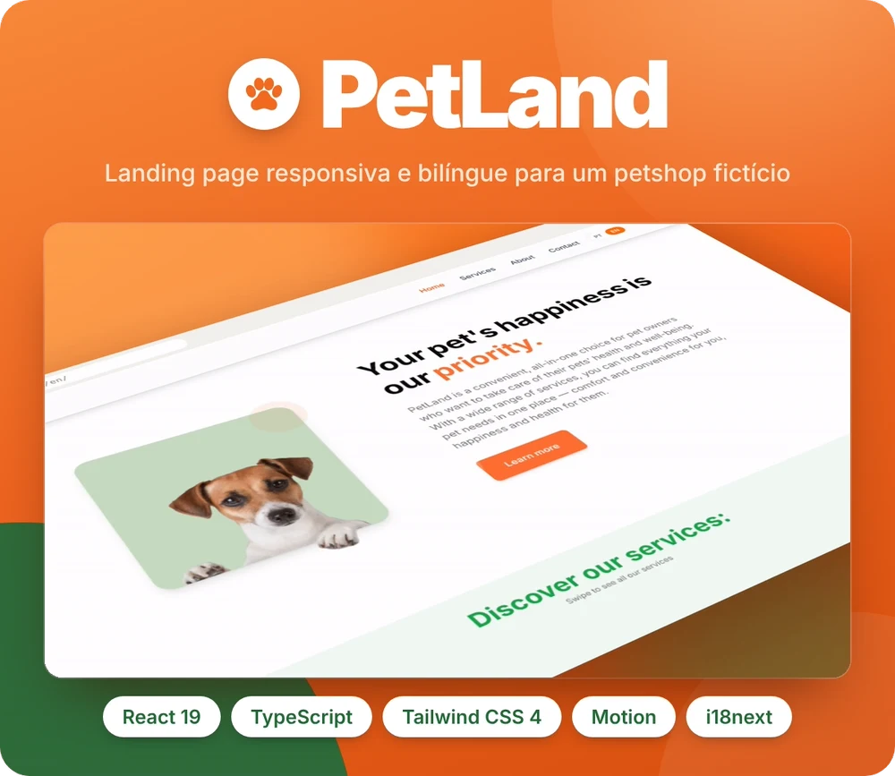
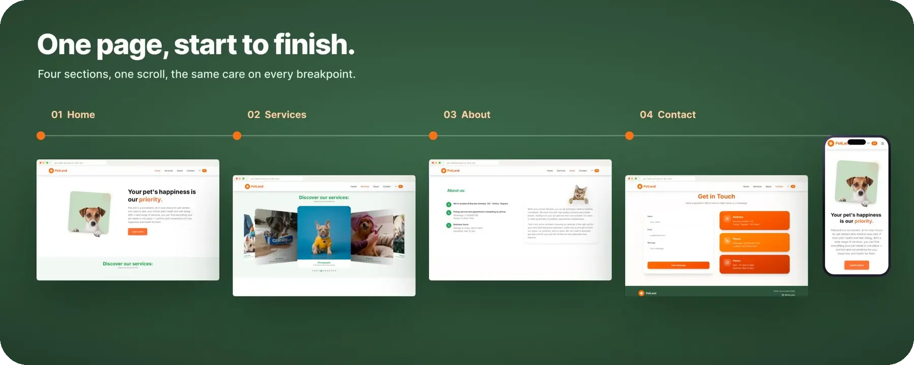
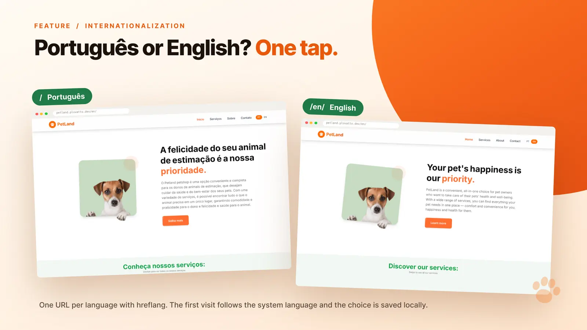
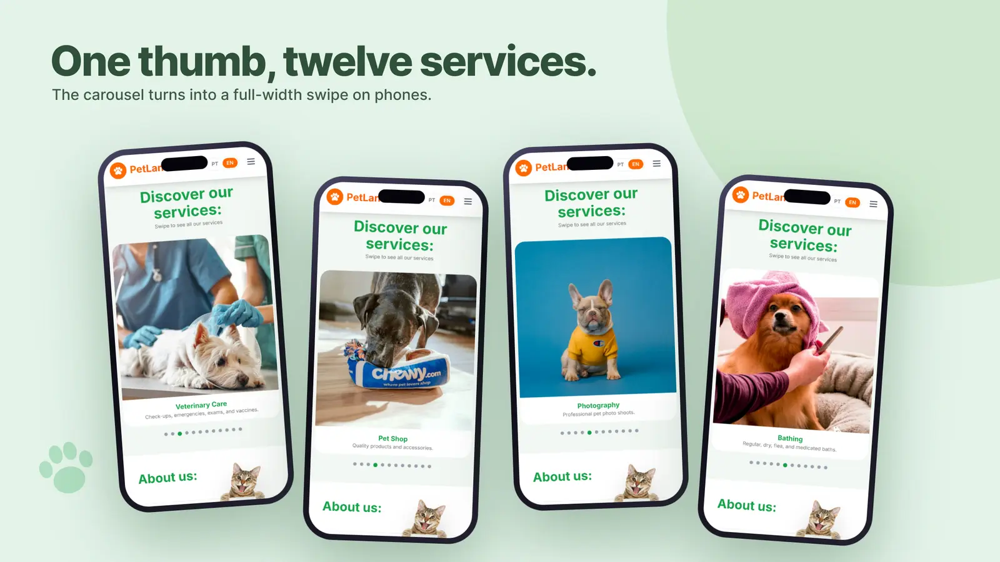
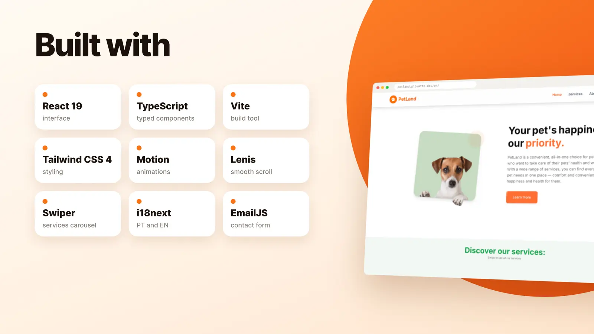
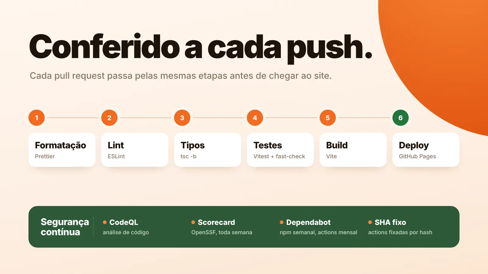

<div align="center">
  <a href="https://petland.plovatto.dev/">
    <picture>
      <source media="(prefers-reduced-motion: reduce)" srcset="./.github/assets/hero-still-pt.webp">
      
    </picture>
  </a>

  <br>
  <br>

<a href="https://petland.plovatto.dev/"></a>
&nbsp;
<a href="README.md"></a>

  <br>
  <br>

<a href="https://github.com/Plovatto/PetLand/actions/workflows/ci.yml"></a>
<a href="https://scorecard.dev/viewer/?uri=github.com/Plovatto/PetLand"></a>
<a href="https://www.bestpractices.dev/projects/16067"></a>
<a href="LICENSE"></a>
</div>

<br>

<p align="center">O PetLand é a landing page de um petshop fictício: uma rolagem, quatro seções, dois idiomas. Faz parte do meu portfólio e foi criado para praticar desenvolvimento front-end, responsividade, componentização, internacionalização e publicação de aplicações React.</p>

<br>

<details>
<summary><strong>Sumário</strong></summary>

- [Visão geral](#visão-geral)
- [Português ou inglês? Um toque.](#português-ou-inglês-um-toque)
- [Doze serviços na ponta do polegar](#doze-serviços-na-ponta-do-polegar)
- [Abra no celular](#abra-no-celular)
- [Funcionalidades](#funcionalidades)
- [Tecnologias](#tecnologias)
- [Qualidade e segurança](#qualidade-e-segurança)
- [Como executar](#como-executar)
- [Scripts](#scripts)
- [Estrutura do projeto](#estrutura-do-projeto)
- [Deploy](#deploy)
- [Objetivos do projeto](#objetivos-do-projeto)
- [Contribuição](#contribuição)
- [Segurança](#segurança)
- [Histórico de versões](#histórico-de-versões)
- [Autoria](#autoria)
- [Licença](#licença)

</details>

## Visão geral

Início, serviços, sobre e contato numa única rolagem, com o mesmo cuidado em todos os tamanhos de tela.



## Português ou inglês? Um toque.

Cada idioma tem sua própria URL com `hreflang`. Na primeira visita, o site segue o idioma do sistema, e a escolha fica salva no navegador.



## Doze serviços na ponta do polegar

No celular, o carrossel de serviços ocupa a largura toda e funciona com um deslizar.



## Abra no celular

O site está publicado no GitHub Pages nos dois idiomas.

<a href="https://petland.plovatto.dev/"></a>

## Funcionalidades

Tudo o que o site de um pequeno negócio precisa, feito com cuidado.

<table>
  <tr>
    <td width="50%" valign="top">
      <p><br><strong>Responsivo em qualquer tela</strong><br>Layout ajustado para todos os tamanhos de tela, com o carrossel de serviços na largura toda e de deslizar no celular.</p>
      <br>
      <p><br><strong>Movimento com cuidado</strong><br>Rolagem suave com Lenis, cursor personalizado, page loader e microinterações que respeitam o "reduzir movimento".</p>
      <br>
      <p><br><strong>Pronto para buscadores</strong><br>Metatags, dados estruturados, <code>robots.txt</code>, <code>sitemap.xml</code> e imagens otimizadas em WebP.</p>
    </td>
    <td width="50%" valign="top">
      <p><br><strong>Dois idiomas, duas URLs</strong><br>Português em <code>/</code> e inglês em <code>/en/</code> com <code>hreflang</code>. A primeira visita segue o idioma do sistema, e a escolha fica salva no navegador.</p>
      <br>
      <p><br><strong>Formulário de contato funcionando</strong><br>As mensagens são enviadas pelo EmailJS, ao lado de endereço, telefone e horários.</p>
      <br>
      <p><br><strong>Testado e verificado</strong><br>Testes de tradução com Vitest e fast-check, além de lint, tipos, build e Lighthouse em cada pull request.</p>
    </td>
  </tr>
</table>

## Tecnologias

Nove bibliotecas, cada uma com um papel claro.



<details>
<summary>Ver cada ferramenta e para que serve</summary>

| Tecnologia                                                                        | Para quê                                    |
| :-------------------------------------------------------------------------------- | :------------------------------------------ |
| [React](https://react.dev/) 19 + [TypeScript](https://www.typescriptlang.org/)    | Interface e componentes tipados             |
| [Vite](https://vite.dev/)                                                         | Servidor de desenvolvimento e build         |
| [Tailwind CSS](https://tailwindcss.com/) 4                                        | Estilos                                     |
| [Framer Motion](https://motion.dev/)                                              | Animações e transições                      |
| [Lenis](https://lenis.darkroom.engineering/)                                      | Rolagem suave                               |
| [Swiper](https://swiperjs.com/)                                                   | Carrossel de serviços                       |
| [i18next](https://www.i18next.com/) + [react-i18next](https://react.i18next.com/) | Internacionalização                         |
| [EmailJS](https://www.emailjs.com/)                                               | Envio do formulário de contato              |
| [Vitest](https://vitest.dev/) + [fast-check](https://fast-check.dev/)             | Testes unitários e baseados em propriedades |
| ESLint + Prettier                                                                 | Análise e formatação do código              |
| GitHub Actions + GitHub Pages                                                     | CI, deploy automatizado e hospedagem        |

</details>

## Qualidade e segurança

Cada pull request passa pelas mesmas verificações antes de chegar ao site.



<details>
<summary>Como funciona cada verificação</summary>

- O workflow [`ci.yml`](.github/workflows/ci.yml) verifica formatação, lint, tipos, testes e build em cada push e pull request para a `main`.
- O [Lighthouse CI](.github/workflows/lighthouse.yml) audita `/` e `/en/` em cada pull request e falha se acessibilidade, boas práticas ou SEO ficarem abaixo de 95.
- Os títulos dos pull requests são conferidos no mesmo formato gitmoji e Conventional Commits dos commits.
- O [CodeQL](https://github.com/Plovatto/PetLand/security/code-scanning) analisa o código, e o [OpenSSF Scorecard](https://scorecard.dev/viewer/?uri=github.com/Plovatto/PetLand) roda toda semana.
- O Dependabot atualiza as dependências npm toda semana e as GitHub Actions todo mês.
- Todas as actions dos workflows são fixadas por hash de commit.

</details>

## Como executar

Requer [Node.js](https://nodejs.org/) 24 (veja o [`.nvmrc`](.nvmrc)) e npm.

1. Clone o repositório e instale as dependências:

   ```bash
   git clone https://github.com/Plovatto/PetLand.git
   cd PetLand
   npm install
   ```

2. Crie o arquivo de variáveis de ambiente:

   ```bash
   cp .env.example .env.local
   ```

3. Preencha as credenciais do EmailJS em `.env.local`:

   ```env
   VITE_EMAILJS_SERVICE_ID=
   VITE_EMAILJS_TEMPLATE_ID=
   VITE_EMAILJS_PUBLIC_KEY=
   ```

4. Inicie o servidor de desenvolvimento e abra <http://localhost:5173>:

   ```bash
   npm run dev
   ```

> [!IMPORTANT]
> O `.env.local` não deve ser versionado. Sem as credenciais, o site funciona normalmente, mas o formulário de contato não envia mensagens.

## Scripts

| Comando                | Descrição                                              |
| :--------------------- | :----------------------------------------------------- |
| `npm run dev`          | Inicia o servidor de desenvolvimento                   |
| `npm run build`        | Executa a checagem de tipos e gera o build de produção |
| `npm run preview`      | Executa localmente o build de produção                 |
| `npm run lint`         | Executa a análise do código com ESLint                 |
| `npm run typecheck`    | Executa a checagem de tipos                            |
| `npm test`             | Executa os testes                                      |
| `npm run test:watch`   | Executa os testes em modo de observação                |
| `npm run format`       | Formata o código com Prettier                          |
| `npm run format:check` | Verifica a formatação sem alterar os arquivos          |
| `npm run lighthouse`   | Roda o Lighthouse CI sobre o build de produção         |

## Estrutura do projeto

<details>
<summary>Ver a árvore de pastas</summary>

```text
src/
├── assets/                 # Imagens e SVGs utilizados pelos componentes
├── components/
│   ├── layout/             # Componentes estruturais, como Header, Footer e PageLoader
│   ├── sections/           # Seções da página, como Hero, Services, About e Contact
│   └── ui/                 # Componentes reutilizáveis, como AnimatedText e LanguageToggle
├── constants/              # Dados estáticos, links e configurações de seções
├── context/                # Contextos globais da aplicação
├── hooks/                  # Hooks customizados
├── lib/                    # Funções utilitárias
├── locales/                # Arquivos de tradução
│   ├── en/
│   └── pt/
├── styles/
│   └── index.css           # Estilos globais e configuração do Tailwind CSS
├── App.tsx
├── i18n.ts
└── main.tsx
```

</details>

## Deploy

<details>
<summary>Como o site é publicado no GitHub Pages</summary>

O deploy é feito pelo workflow [`deploy.yml`](.github/workflows/deploy.yml). A cada push na branch `main`, ele gera o build e publica a pasta `dist`.

O site é servido no domínio personalizado `petland.plovatto.dev`, por isso o Vite usa `base: '/'`. Para publicar, crie no DNS do domínio um registro `CNAME` de `petland` para `plovatto.github.io` e configure no GitHub:

```text
Settings > Pages > Build and deployment > Source: GitHub Actions
Settings > Pages > Custom domain: petland.plovatto.dev
```

</details>

## Objetivos do projeto

O PetLand foi desenvolvido para praticar e demonstrar:

- Interfaces com React e TypeScript, componentizadas e reutilizáveis
- Layouts responsivos e organização de projetos front-end
- Animações, microinterações e respeito às preferências de movimento
- Acessibilidade e internacionalização
- Integração com serviços externos
- Deploy automatizado e boas práticas de Git e GitHub

## Contribuição

Issues e pull requests são bem-vindos. Leia o [guia de contribuição](CONTRIBUTING.md) para as convenções de branch, commit e pull request, e siga o [código de conduta](CODE_OF_CONDUCT.md). Ambos estão em inglês.

## Segurança

Não abra issues públicas para vulnerabilidades. Reporte de forma privada, como descrito na [política de segurança](SECURITY.md).

## Histórico de versões

As mudanças de cada versão estão no [CHANGELOG](CHANGELOG.md) (em inglês) e na [página de releases](https://github.com/Plovatto/PetLand/releases).

## Autoria

**Pandora Becker Lovatto** · [@Plovatto](https://github.com/Plovatto)

## Licença

Distribuído sob a [Licença MIT](LICENSE).

<br>

<p align="center"><a href="#readme"></a></p>
